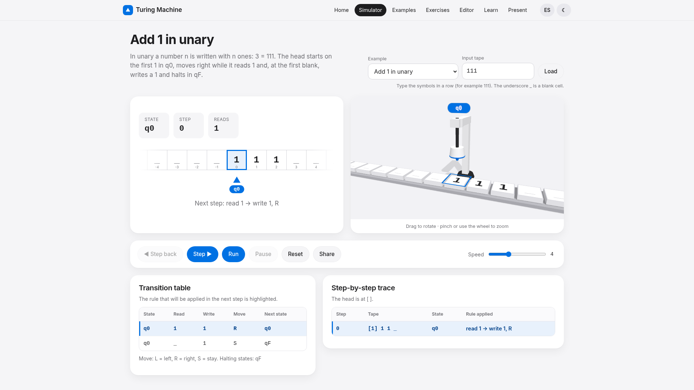
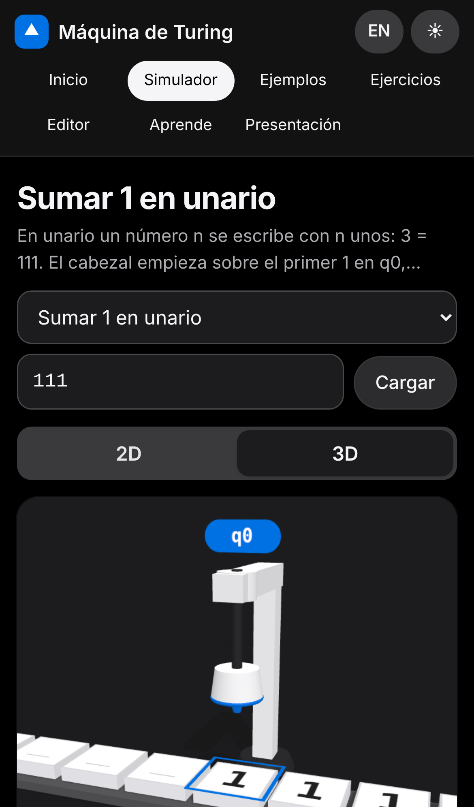
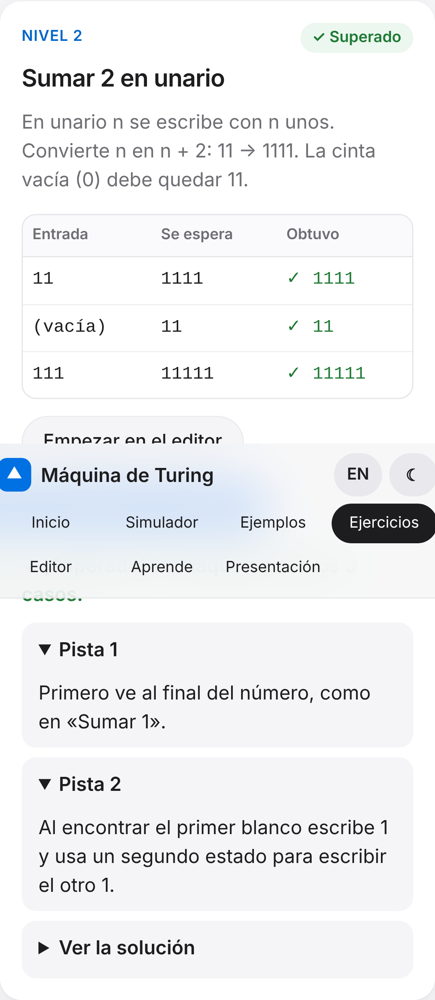
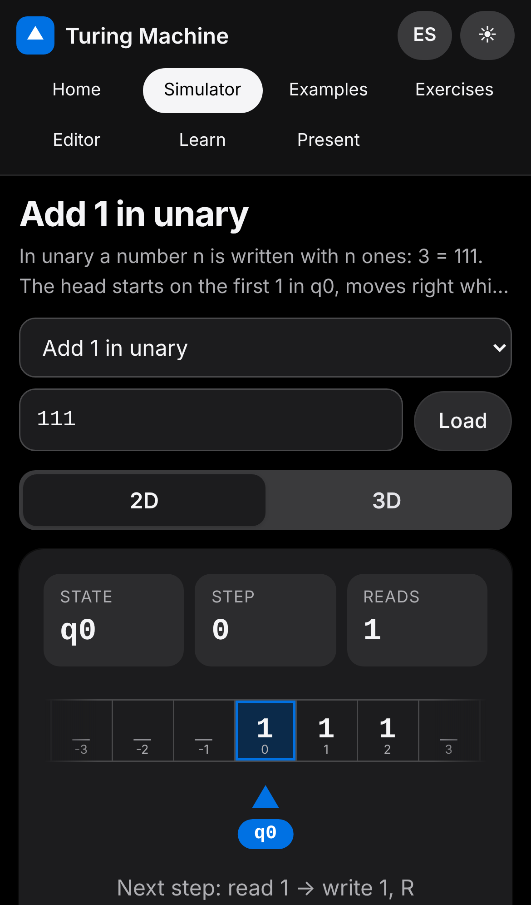

# Turing Machine · 2D and 3D simulator

[Español](README.md) · **English**

[](https://github.com/NickPro5677/maquina-de-turing/actions/workflows/ci.yml) [](https://github.com/NickPro5677/maquina-de-turing/actions/workflows/pages.yml) [](LICENSE)

An interactive Turing machine simulator that runs in the browser, on phones and on a projector. It needs no install and works offline after the first visit.

**[Open the live demo](https://nickpro5677.github.io/maquina-de-turing/)**. The interface starts in Spanish; tap **EN** in the top bar to switch to English. Your choice is remembered.



| Dark mode | Exercise passed | English on a phone |
|---|---|---|
|  |  |  |

## Features

- **Simulator**: step, step back, run, pause, run to the end, reset, speed and a step limit. A transition table that highlights the active rule, and a step-by-step trace (on a long tape, only a window around the head).
- **3D view** (Three.js, vendored in the repo): rotate it with a finger or the mouse. It respects the system's reduced-motion setting.
- **11 examples**: add 1 in unary, invert bits, add two unary numbers, binary increment, palindrome, copy a string, parity, double a binary number, 2- and 3-state busy beavers, and an endless loop.
- **Exercises**: 5 challenges. Each has a goal, test cases checked automatically with a step limit, hints that open in order, and the solution last.
- **Editor**: build rules in a table with live validation. Save named machines on the device and open or delete them later. Export to `.json`; imports are validated before loading.
- **Share**: the **Share** button makes a link with the machine inside it, so anyone who opens the link sees it in the simulator. On phones it opens the system share sheet.
- **Dark mode**: follows the system and can be toggled with ☾/☀. The 2D and 3D views both adapt.
- **Spanish and English**: the whole interface, the theory texts and the engine messages are translated. In English, moves are written **L / R / S**. The parser accepts both I/D/N and L/R/S.
- **Learn**: what the machine is, Turing in 1936, the universal machine, the Church–Turing thesis, the halting problem, why it matters today, a timeline and references.
- **Presentation mode**: large type, full screen, and arrow-key or clicker control (Page Down / Page Up).

## Usage

- **Phone:** open the demo and tap **Try the machine**. To install it, choose *Add to Home Screen* in the browser menu.
- **Single offline file:** download [`maquina-turing.html`](https://nickpro5677.github.io/maquina-de-turing/maquina-turing.html), which is also attached to each release. Everything is inside the file, so it opens from `file://` with no server and no internet.
- **Desktop:** serve the repo with any static server (`python3 -m http.server 8000`).
- **Shortcuts:** → step, ← step back, space run/pause, R reset.

Rules can also be pasted as text, one per line:

```text
q0, 1 -> 1, R, q0
q0, _ -> 1, S, qF
```

## Development

```bash
npm install     # only needed for the single-file build (esbuild)
npm test        # 92 tests with node --test
npm run build   # writes dist/maquina-turing.html
```

The engine in `src/motor/` is plain JavaScript with no DOM. UI strings live in `src/i18n/es.js` and `src/i18n/en.js`, and a test checks that both files have the same keys.

## License

[MIT](LICENSE). Three.js ships with its own MIT license in [`vendor/three/LICENSE`](vendor/three/LICENSE).
