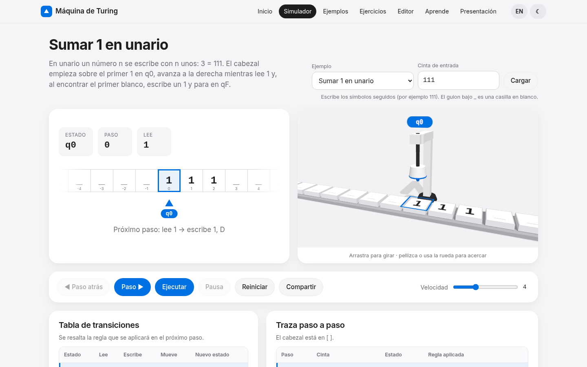
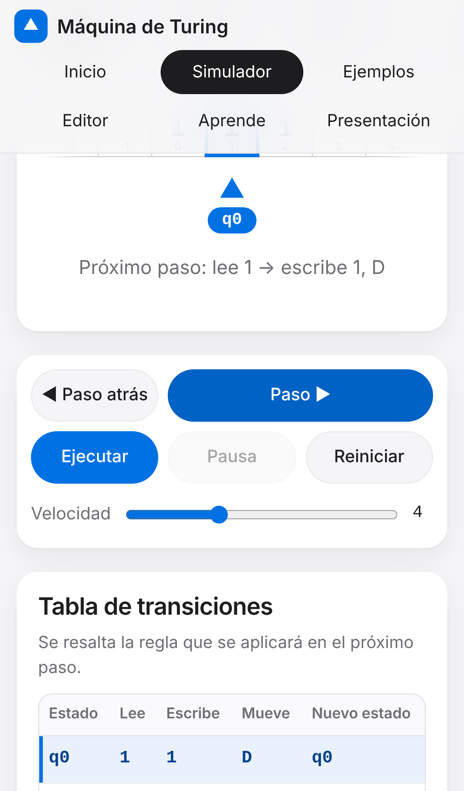
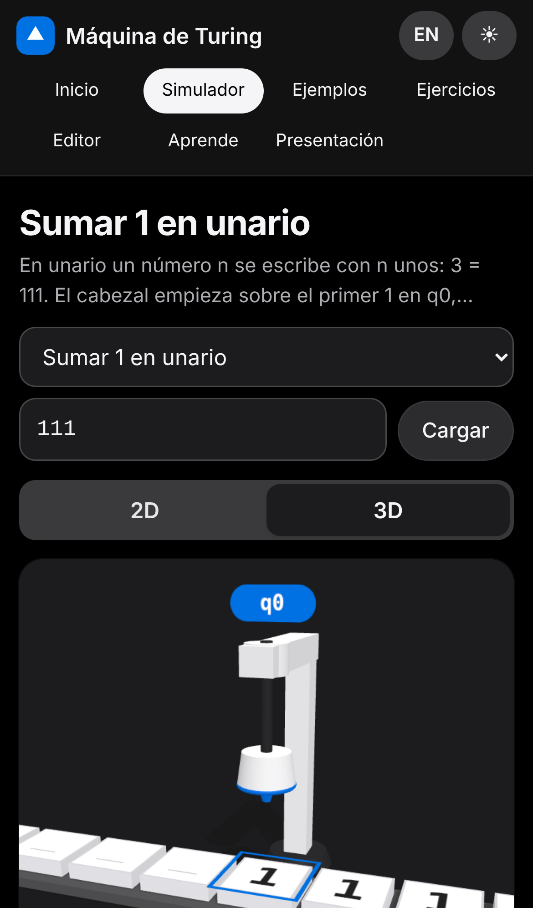
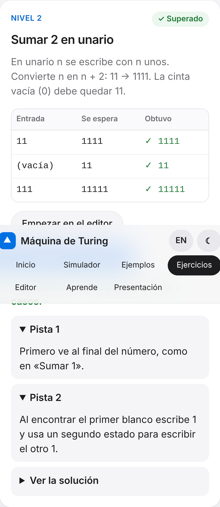
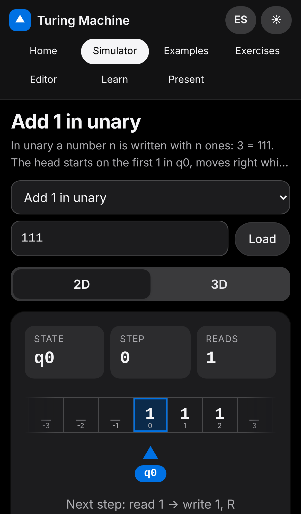
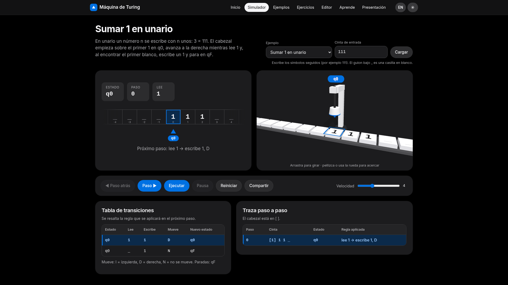

# Máquina de Turing

Simulador interactivo de la máquina de Turing, en 2D y 3D. Funciona en el teléfono, en la computadora y en un proyector, sin internet.

**Español** · [English](README.en.md)

[](https://github.com/NickPro5677/maquina-de-turing/actions/workflows/ci.yml)
[](LICENSE)

**Demo:** https://nickpro5677.github.io/maquina-de-turing/

También hay un [archivo único](https://nickpro5677.github.io/maquina-de-turing/maquina-turing.html) (`maquina-turing.html`) que se abre con doble clic, sin servidor.



| Teléfono · 2D | Teléfono · 3D | Modo presentación |
|---|---|---|
|  |  |  |

| Modo oscuro | Ejercicio superado | En inglés |
|---|---|---|
|  |  |  |



## Para qué sirve

Sirve para ver cómo trabaja una máquina de Turing: la cinta, el cabezal, el estado y las reglas. En 2D se ve la tabla y la traza. En 3D se ve una máquina que baja el brazo, lee, escribe y mueve la cinta.

## Qué incluye

- **Simulador:** paso, paso atrás, ejecutar, pausa, correr hasta el final, reiniciar, velocidad y un límite de pasos que se puede cambiar (entre 1 y 1 000 000; 10 000 por defecto). La tabla resalta la regla activa. La traza es paso a paso; en cintas largas solo muestra una ventana alrededor del cabezal.
- **Vista 3D** (Three.js, incluido en el repo): se gira con el dedo o el ratón. Reutiliza las casillas visibles. Respeta la opción «reducir movimiento» del sistema.
- **11 ejemplos:** sumar 1 en unario, invertir bits, sumar dos números unarios, incrementador binario, palíndromo, copiar una cadena, paridad, doblar un binario, castor atareado de 2 y de 3 estados, y un bucle sin fin.
- **Ejercicios:** 5 retos con objetivo, casos de prueba que se comprueban solos (con límite de pasos), pistas que se abren en orden y la solución al final.
- **Editor:** reglas en una tabla, con validación en vivo. Se pueden guardar varias máquinas con nombre en el dispositivo (abrir o borrar; antes de borrar, la página pregunta). Exporta un `.json` e impórtalo con validación.
- **Compartir:** el botón **Compartir** crea un enlace con la máquina dentro. En el teléfono abre el menú de compartir del sistema.
- **Modo oscuro:** sigue al sistema y se puede cambiar con el botón ☾/☀. Se adaptan las vistas 2D y 3D.
- **Español e inglés:** botón **EN/ES** arriba. Toda la interfaz, la cinta 2D y los textos de teoría están traducidos. En inglés los movimientos son L / R / S.
- **Aprende:** qué es, Turing en 1936, la máquina universal, la tesis de Church–Turing, el problema de la parada, su importancia hoy, una línea de tiempo y referencias.
- **Modo presentación:** letra grande, pantalla completa y control con flechas o con un presentador (Av Pág / Re Pág).

## El ejemplo principal: sumar 1 en unario

En unario un número *n* se escribe con *n* unos (3 = `111`). El cabezal empieza sobre el primer 1, en el estado `q0`:

| Estado | Lee | Escribe | Mueve | Nuevo estado |
|---|---|---|---|---|
| q0 | 1 | 1 | D (derecha) | q0 |
| q0 | _ | 1 | N (no se mueve) | qF (parar) |

| Paso | Cinta (cabezal en [ ]) | Estado | Regla aplicada |
|---|---|---|---|
| 0 | [1] 1 1 _ | q0 | lee 1 → escribe 1, D |
| 1 | 1 [1] 1 _ | q0 | lee 1 → escribe 1, D |
| 2 | 1 1 [1] _ | q0 | lee 1 → escribe 1, D |
| 3 | 1 1 1 [_] | q0 | lee _ → escribe 1, para |
| 4 | 1 1 1 [1] | qF | FIN: resultado 1111 |

## Cómo usarlo

### En el teléfono

1. Abre la [demo](https://nickpro5677.github.io/maquina-de-turing/).
2. Toca **Probar la máquina**. Usa las pestañas **2D / 3D** y los botones de abajo.
3. Para tenerla como app: en el menú del navegador elige **Agregar a la pantalla de inicio**. Después de la primera visita funciona sin internet.

### Sin internet, en un solo archivo

Descarga `maquina-turing.html` (está en la [demo](https://nickpro5677.github.io/maquina-de-turing/maquina-turing.html) y se genera con `npm run build`). Es un único archivo con todo dentro: ábrelo con doble clic en la computadora o desde la app de archivos del teléfono. No necesita servidor ni internet.

### En la computadora

Abre la demo o sirve la carpeta del repo con cualquier servidor estático:

```bash
python3 -m http.server 8000
# y abre http://localhost:8000
```

Atajos del simulador: **→** paso, **←** paso atrás, **espacio** ejecutar/pausa, **R** reiniciar. Siguen funcionando aunque el foco esté en un botón. Si estás escribiendo en un campo, no se disparan. Las pestañas 2D y 3D también se cambian con las flechas.

### En clase, con proyector

Ve a **Presentación**. Más detalles en [docs/presentacion.md](docs/presentacion.md).

## Crea tu propia máquina

1. Entra en **Editor**.
2. Escribe el estado inicial, los estados finales y la cinta de entrada.
3. Añade reglas: *estado, lee, escribe, mueve (I, D o N), nuevo estado*. El símbolo `_` es la casilla en blanco.
4. Los errores salen en rojo (reglas repetidas, estados sin reglas, movimientos no válidos…) y los avisos en amarillo (por ejemplo, combinaciones sin regla).
5. Pulsa **Probar en el simulador**. Puedes **Guardar** la máquina con su nombre, **Exportar JSON**, **Importar JSON** (se valida antes de cargar) o **Compartir enlace**.

También puedes pegar reglas como texto, una por línea:

```text
q0, 1 -> 1, D, q0
q0, _ -> 1, N, qF
```

Formato JSON:

```json
{
  "formato": "maquina-de-turing/1",
  "nombre": "Sumar 1 en unario",
  "blanco": "_",
  "inicial": "q0",
  "finales": ["qF"],
  "entrada": "111",
  "reglas": [["q0", "1", "1", "D", "q0"], ["q0", "_", "1", "N", "qF"]]
}
```

## Cómo funciona el motor

El motor está en [`src/motor/`](src/motor/) y es JavaScript puro, sin DOM, así que se prueba con Node. Guarda la cinta como un mapa *posición → símbolo* (la cinta es ilimitada hacia ambos lados) y en cada paso:

1. lee el símbolo bajo el cabezal;
2. busca la regla para *(estado, símbolo)*;
3. escribe, mueve el cabezal y cambia de estado;
4. guarda lo necesario para poder dar **paso atrás**.

Para cuando llega a un estado final, de aceptación o de rechazo, o cuando no hay regla. Como no se puede saber en general si una máquina parará (problema de la parada), hay un **límite de pasos** (10 000 por defecto, editable). Detalles en [docs/motor.md](docs/motor.md).

## Estructura de archivos

```text
maquina-de-turing/
├── index.html                 # La página (todas las pantallas)
├── css/estilos.css            # Estilo, tema claro y oscuro
├── src/
│   ├── app.js                 # Rutas, simulador, editor, ejercicios, aprende, presentación, tema e idioma
│   ├── motor/                 # Motor puro: máquina, ejemplos, ejercicios, enlace, biblioteca, textos
│   ├── i18n/                  # Textos de la interfaz: es.js, en.js
│   └── ui/                    # vista2d.js, vista3d.js, poolCasillas.js, aprende.js, aprende.en.js
├── vendor/three/              # Three.js r170 + OrbitControls (licencia MIT)
├── sw.js, manifest.webmanifest, icons/   # Uso sin internet e instalación
├── scripts/construir-archivo-unico.mjs   # Genera dist/maquina-turing.html
├── tests/                     # 92 pruebas con node --test
├── docs/                      # motor.md, presentacion.md, capturas
└── .github/workflows/         # ci.yml y pages.yml
```

## Tecnologías

- JavaScript (módulos ES, sin framework)
- HTML y CSS
- Three.js r170 (incluido en `vendor/three/`)
- Service worker y manifiesto (PWA)
- Node.js solo para las pruebas y para construir el archivo único (`esbuild`)
- GitHub Pages

## Pruebas

```bash
npm install     # solo hace falta para construir el archivo único (esbuild)
npm test        # 92 pruebas con node --test, sin dependencias
npm run build   # crea dist/maquina-turing.html
```

Las pruebas comprueban la traza exacta 111 → 1111, el resultado y los pasos de cada ejemplo, la aceptación y el rechazo de palíndromos, los castores atareados (2 estados: 4 unos en 6 pasos; 3 estados: 6 unos en 14 pasos, y la máquina de 21 pasos), el límite de pasos, el paso atrás, el validador y el JSON. Desde la v1.1.0 también: enlaces de ida y vuelta y enlaces dañados, la validación al importar, el corrector de ejercicios, las máquinas guardadas y que el español y el inglés tengan las mismas claves. Desde la v1.2.0: la traza de una cinta larga, el límite de pasos que se puede cambiar y el pool de la vista 3D.

Si quieres proponer un cambio, mira [CONTRIBUTING.md](CONTRIBUTING.md).

## Estado

Activo. El código en `main` es la **v1.2.0** (18 de noviembre de 2026). La [demo](https://nickpro5677.github.io/maquina-de-turing/) ya la sirve. La última *release* de GitHub sigue en [v1.1.0](https://github.com/NickPro5677/maquina-de-turing/releases/tag/v1.1.0); aún no hay etiqueta `v1.2.0`.

No hay issues abiertos. Historial en [CHANGELOG.md](CHANGELOG.md).

## Licencia

[MIT](LICENSE). Three.js se incluye con su propia licencia MIT en [`vendor/three/LICENSE`](vendor/three/LICENSE).

## Referencias

- Turing, A. M. (1937). *On Computable Numbers, with an Application to the Entscheidungsproblem*. Proceedings of the London Mathematical Society, s2-42(1), 230–265. https://doi.org/10.1112/plms/s2-42.1.230
- De Mol, L. *Turing Machines*. Stanford Encyclopedia of Philosophy. https://plato.stanford.edu/entries/turing-machine/
- Copeland, B. J. *The Church-Turing Thesis*. Stanford Encyclopedia of Philosophy. https://plato.stanford.edu/entries/church-turing/
- Encyclopaedia Britannica. *Turing machine*. https://www.britannica.com/technology/Turing-machine
- The Turing Digital Archive. https://turingarchive.kings.cam.ac.uk/
